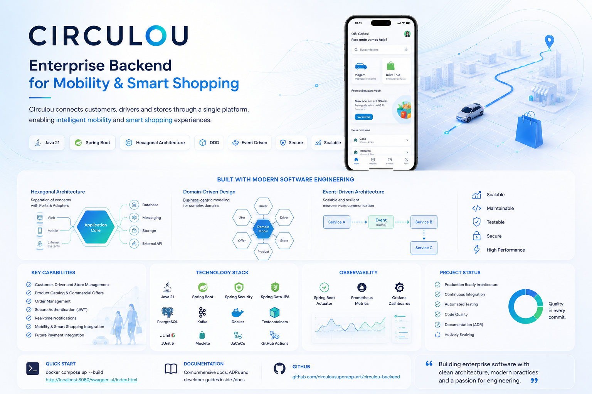

# 🚀 Circulou Backend

Enterprise-grade backend for the Circulou Super App, designed with modern software engineering practices to deliver a scalable, secure and maintainable platform for mobility and smart shopping.

<p align="center">

</p>

---

# 📖 About the Project

Circulou is a long-term software engineering project created to solve a real-world problem while serving as a professional backend portfolio.

The platform connects customers, drivers and stores through a single ecosystem, enabling purchases to be synchronized with users' travel routes, reducing waiting time and improving the shopping experience.

Although the product vision continues to evolve, the primary goal of this repository is to demonstrate production-ready backend engineering using modern architectural patterns and industry best practices.

---

# 🏗 Architecture

The project follows **Hexagonal Architecture (Ports & Adapters)** combined with:

- Domain-Driven Design (DDD)
- SOLID Principles
- Clean Architecture
- Separation of Concerns
- High Cohesion
- Low Coupling

Current architectural flow:

Controller
↓
Facade
↓
Use Case
↓
Service
↓
Repository Port
↓
Repository Adapter
↓
Spring Data JPA
↓
PostgreSQL

---

# ⚙ Technology Stack

### Backend

- Java 21
- Spring Boot 3.5
- Spring Security
- JWT Authentication
- Spring Data JPA
- Hibernate
- Bean Validation
- MapStruct
- Lombok

### Database

- PostgreSQL
- Flyway

### Testing

- JUnit 5
- Mockito
- Testcontainers
- JaCoCo

### DevOps

- Docker
- Docker Compose
- GitHub Actions
- Maven

### Observability

- Spring Boot Actuator
- Micrometer
- Prometheus
- Grafana
- Kafka UI

### Documentation

- Swagger / OpenAPI
- ADR Documentation
- Markdown

---

# 🔐 Security

Implemented features include:

- JWT Authentication
- BCrypt Password Encryption
- Stateless Authentication
- Custom Authentication Entry Point
- Custom Access Denied Handler
- Global Exception Handling
- Bean Validation

---

# 📦 Main Modules

Current business domains and infrastructure include:

- Authentication
- User Management
- Customer Profile
- Driver Profile
- Store Profile
- Product Catalog
- Commercial Offers
- Orders
- Order Items
- Mobility
- Event Infrastructure
- Observability
- Infrastructure

---

# 🧪 Quality

Current engineering practices:

- Unit Testing
- Integration Testing
- Testcontainers
- JaCoCo Coverage
- Dockerized Environment
- Continuous Integration
- Architecture Decision Records (ADR)

Every push is automatically validated by GitHub Actions before becoming part of the project's history.

---

# 🐳 Running with Docker

```bash
docker compose up -d
```

---

# ▶ Running Locally

Requirements

- Java 21
- Docker Desktop
- PostgreSQL

Clone

```bash
git clone https://github.com/circulousuperapp-art/circulou-backend.git
cd circulou-backend
```

# Start infrastructure

```bash
docker compose up -d
```

Wait until PostgreSQL and Kafka become healthy.

# Run backend

```bash
./mvnw spring-boot:run
```

---

# 🧪 Running Tests

Recommended command

```bash
./mvnw clean verify
```

---

# 📖 API & Observability

### Swagger UI

```text
http://localhost:8080/swagger-ui/index.html
```

### Actuator

```text
http://localhost:8080/actuator
```

### Prometheus

```text
http://localhost:9090
```

### Grafana

```text
http://localhost:3000
```

---

# 📈 Project Vision

Circulou is much more than a study project.

It represents an ongoing software engineering journey where architecture, backend development, software quality, DevOps and product engineering evolve together.

Each sprint improves both the platform and the engineering practices behind it.

The project is actively evolving toward a production-ready MVP while continuously adopting modern software engineering practices.

---

# 👨‍💻 Author

Pedro Arthur

Backend Software Engineer

LinkedIn

https://www.linkedin.com/in/pedroarthurdev/

GitHub

https://github.com/circulousuperapp-art