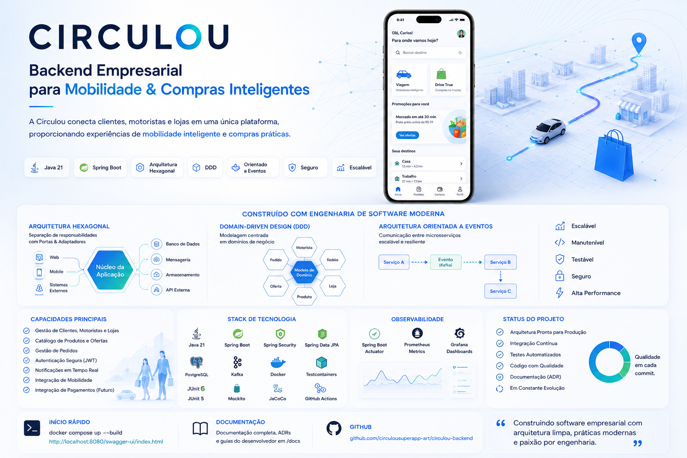

# 🚀 Circulou Backend

Backend empresarial do Circulou Super App, desenvolvido utilizando práticas modernas de Engenharia de Software para entregar uma plataforma escalável, segura e preparada para evolução contínua.

<p align="center">

</p>

---

# 📖 Sobre o Projeto

O Circulou é um projeto de Engenharia de Software desenvolvido para solucionar um problema real enquanto serve como portfólio profissional de Backend.

A plataforma conecta clientes, motoristas e estabelecimentos em um único ecossistema, permitindo sincronizar compras com o deslocamento do usuário, reduzindo tempo de espera e melhorando a experiência de compra.

Além da visão de produto, este repositório demonstra a construção de um backend utilizando arquitetura moderna, boas práticas e padrões utilizados em ambientes corporativos.

---

# 🏗 Arquitetura

O projeto segue **Arquitetura Hexagonal (Ports & Adapters)** combinada com:

- Domain-Driven Design (DDD)
- Princípios SOLID
- Clean Architecture
- Separação de Responsabilidades
- Alta Coesão
- Baixo Acoplamento

Fluxo arquitetural atual:

Controller
↓
Facade
↓
Use Case
↓
Service
↓
Repository Port
↓
Repository Adapter
↓
Spring Data JPA
↓
PostgreSQL

---

# ⚙ Stack Tecnológica

### Backend

- Java 21
- Spring Boot 3.5
- Spring Security
- JWT
- Spring Data JPA
- Hibernate
- Bean Validation
- MapStruct
- Lombok

### Banco de Dados

- PostgreSQL
- Flyway

### Testes

- JUnit 5
- Mockito
- Testcontainers
- JaCoCo

### DevOps

- Docker
- Docker Compose
- GitHub Actions
- Maven

### Observabilidade

- Spring Boot Actuator
- Micrometer
- Prometheus
- Grafana
- Kafka UI

### Documentação

- Swagger / OpenAPI
- ADRs
- Markdown

---

# 🔐 Segurança

O projeto implementa:

- Autenticação JWT
- Criptografia BCrypt
- Segurança Stateless
- Authentication Entry Point customizado
- Access Denied Handler customizado
- Tratamento Global de Exceções
- Bean Validation

---

# 📦 Principais Módulos

Domínios e infraestrutura atualmente implementados:

- Autenticação
- Gestão de Usuários
- Perfil de Cliente
- Perfil de Motorista
- Perfil de Lojista
- Catálogo de Produtos
- Ofertas Comerciais
- Pedidos
- Itens do Pedido
- Mobilidade
- Infraestrutura de Eventos
- Observabilidade
- Infraestrutura

---

# 🧪 Qualidade

Práticas adotadas atualmente:

- Testes Unitários
- Testes de Integração
- Testcontainers
- Cobertura JaCoCo
- Ambiente Dockerizado
- Integração Contínua
- Architecture Decision Records (ADR)

Todo push é validado automaticamente pelo GitHub Actions antes de integrar o histórico do projeto.

---

# 🐳 Executando com Docker

```bash
docker compose up -d
```

---

# ▶ Executando Localmente

Requisitos

- Java 21
- Docker Desktop
- PostgreSQL

Clone

```bash
git clone https://github.com/circulousuperapp-art/circulou-backend.git
cd circulou-backend
```

# Inicializar infraestrutura

```bash
docker compose up -d
```

Aguarde PostgreSQL e Kafka ficarem saudáveis.

# Executar backend

```bash
./mvnw spring-boot:run
```

---

# 🧪 Executando os Testes

Comando recomendado

```bash
./mvnw clean verify
```

---

# 📖 API & Observabilidade

### Swagger UI

```text
http://localhost:8080/swagger-ui/index.html
```

### Actuator

```text
http://localhost:8080/actuator
```

### Prometheus

```text
http://localhost:9090
```

### Grafana

```text
http://localhost:3000
```

---

# 📈 Visão do Projeto

O Circulou vai além de um projeto acadêmico.

Ele representa uma jornada contínua de Engenharia de Software, onde arquitetura, desenvolvimento backend, qualidade, DevOps e engenharia de produto evoluem juntos a cada Sprint.

Cada entrega fortalece tanto a plataforma quanto a maturidade técnica aplicada ao projeto.

O projeto evolui continuamente em direção a um MVP preparado para produção, incorporando práticas modernas de engenharia de software.

---

# 👨‍💻 Autor

Pedro Arthur

Backend Software Engineer

LinkedIn

https://www.linkedin.com/in/pedroarthurdev/

GitHub

https://github.com/circulousuperapp-art