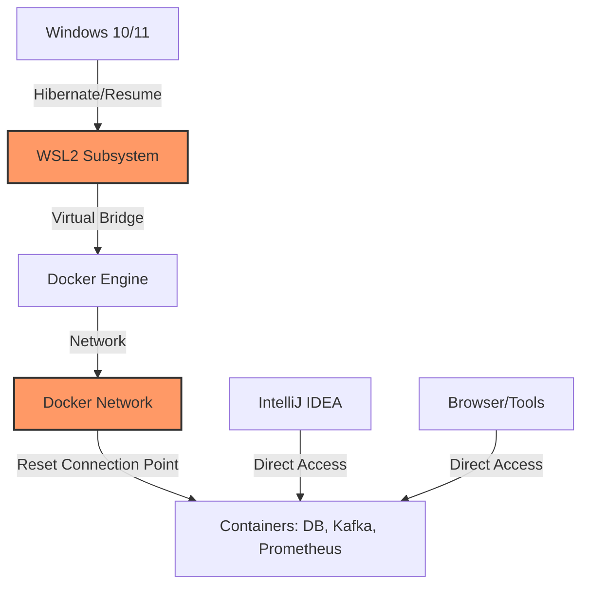

# ADR-007 — Recuperação do Ambiente de Desenvolvimento (WSL2 + Docker Desktop)

#infraestrutura #adr #docker #wsl2 #windows #dev-experience #recovery

## Status

✅ Aprovada

## Data

03/08/2026

---

## Contexto

O ambiente de desenvolvimento do Circulou Backend utiliza uma arquitetura híbrida onde o banco de dados (PostgreSQL), mensageria (Kafka) e ferramentas de observabilidade (Prometheus, Grafana) rodam em containers via Docker Desktop no Windows, enquanto a aplicação (Backend) é executada diretamente na IDE (IntelliJ IDEA) para facilitar o debug e hot-reload.

No Windows, o Docker Desktop opera sobre a camada do WSL2 (Windows Subsystem for Linux).

## Architecture Flow

O diagrama abaixo representa a cadeia de dependências e o ponto de falha identificado:

## Problema

Identificou-se que, após longos períodos de inatividade ou retorno de hibernação do sistema operacional Windows, pode ocorrer uma "inconsistência silenciosa" na ponte de rede entre o WSL2 e o host Windows.

### Sintomas observados:
1.  O Docker Desktop e os containers aparecem como "Running" (Saudáveis).
2.  Testes de conexão de porta (como `Test-NetConnection`) retornam sucesso.
3.  No entanto, requisições via Browser, `curl` ou `Invoke-WebRequest` para os serviços (Prometheus, Grafana, Kafka UI) resultam em `ERR_CONNECTION_RESET`.
4.  O Backend no IntelliJ pode apresentar falhas intermitentes de conexão com o PostgreSQL ou Kafka, mesmo com os containers ativos.

## Operational Recovery Protocol

### Causa Raiz Identificada
O subsistema de rede do WSL2 pode perder a sincronia com a interface virtual do Docker Desktop após o ciclo de suspensão/hibernação do Windows, resultando em sockets "zumbis" que aceitam a conexão inicial mas resetam o tráfego de dados imediatamente.

### Protocolo Oficial de Recuperação
Estabelecemos um **Protocolo Oficial de Recuperação de Infraestrutura** para garantir o determinismo do ambiente de desenvolvimento.

| Passo | Comando | Objetivo |
| :--- | :--- | :--- |
| 1 | `wsl --shutdown` | Forçar o desligamento do kernel do WSL2 e limpeza de interfaces. |
| 2 | `docker compose down` | Encerrar containers e redes órfãs no Docker. |
| 3 | `docker compose up -d` | Reiniciar a infraestrutura de apoio. |

### Justificativa Técnica
Diferente de um simples `restart` de container, o `wsl --shutdown` reinicializa toda a stack de virtualização leve, garantindo que as tabelas de roteamento virtual do Hyper-V/WSL sejam recriadas do zero.

### Limitações e Boas Práticas
*   **Porta 8080:** O backend executado pelo IntelliJ ocupa a porta 8080. O container `backend` deve estar parado para evitar conflitos.
*   **Persistência:** O protocolo é seguro e não remove volumes (`docker-compose down` sem a flag `-v`).
*   **Prevenção:** Recomenda-se fechar o Docker Desktop antes de colocar o host em hibernação profunda.

---

## Decisão Arquitetural

Estabelecemos o uso de automação profissional via PowerShell para a gestão da infraestrutura local, garantindo que o protocolo de recuperação (ADR-007) seja acessível a todos os desenvolvedores através de uma interface simplificada e informativa.

Foi decidido, após validação técnica, que os scripts PowerShell atuam como **ferramentas de apoio operacional (Developer Experience)** e não como mecanismos de recuperação autônoma do sistema operacional.

A responsabilidade pela integridade das camadas Windows, WSL2 e Docker Desktop permanece com o sistema operacional e a supervisão do desenvolvedor. Os scripts limitam-se a executar a sequência operacional do protocolo oficial, sem assumir a capacidade de corrigir falhas intrínsecas ao kernel do WSL2 ou do Docker Engine de forma automatizada.

---

## Consequências

### Benefícios
*   **Determinismo:** Elimina horas de debug em "problemas fantasma" de rede ao fornecer um fluxo claro de reinicialização.
*   **Confiabilidade:** Melhora a estabilidade da coleta de dados de observabilidade.
*   **Transparência:** O dashboard informativo permite ao desenvolvedor identificar rapidamente onde a cadeia de infraestrutura está rompida.

### Trade-offs
*   **Responsabilidade Manual:** A validação final da eficácia da recuperação permanece sob responsabilidade do desenvolvedor.
*   **Scope Limit:** O projeto não automatiza correções de drivers ou configurações de baixo nível do Windows.

---

## Automação Operacional

Para facilitar a gestão operacional do ambiente, os seguintes scripts foram disponibilizados na pasta `scripts/`:

*   `dev-start.ps1`: Inicializa a infraestrutura Docker (Postgres, Kafka, Observabilidade) necessária ao desenvolvimento.
*   `dev-stop.ps1`: Encerra a infraestrutura de apoio de forma limpa.
*   `dev-status.ps1`: Apresenta um dashboard informativo para diagnóstico rápido da saúde da stack e das portas utilizadas.
*   `dev-recover.ps1`: Executa a sequência oficial do protocolo definido nesta ADR, servindo como ponto de partida para a restauração do ambiente após falhas de conectividade.

---

## Relações e Impactos

### Relação com a Sprint 46/47
Esta ADR complementa as melhorias de observabilidade, garantindo que o Prometheus (configurado via `prometheus-dev.yml`) consiga sempre alcançar o `host.docker.internal` através de uma ponte de rede estável.
